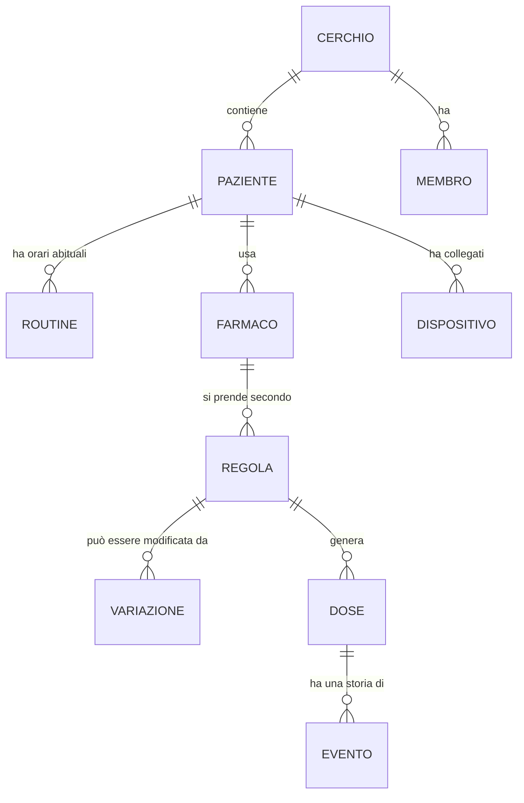
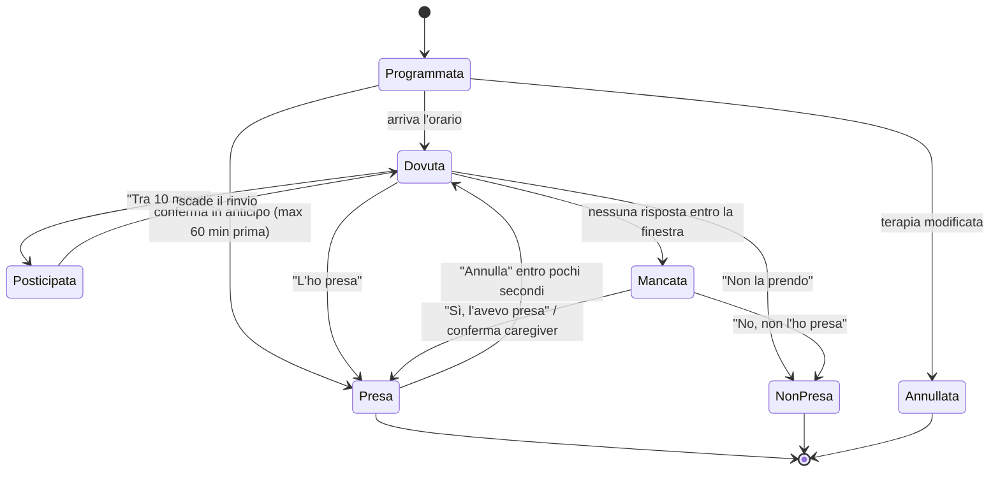

# 2. Modello della terapia

Questo è il cuore di Pinnuli: come si descrive una terapia reale, con tutte le sue eccezioni, in modo che il sistema sappia **quale dose è dovuta, quando, e in che quantità**.

## 2.1 Concetti

| Concetto | Definizione | Esempio |
|----------|-------------|---------|
| **Farmaco** | Il prodotto fisico che il paziente ha in casa. | "Sinemet 100/25 compresse" |
| **Regola di assunzione** | Quando e quanto di quel farmaco. Un farmaco può avere più regole. | "1 compressa alle 08:30 tutti i giorni" |
| **Routine** | Gli orari abituali della giornata del paziente, a cui le regole possono agganciarsi. | Sveglia 07:30, pranzo 13:00, cena 20:00 |
| **Variazione temporanea** | Una modifica a una o più regole valida per un periodo, che poi si annulla da sola. | "Dal 10 al 12 novembre il Sinemet delle 19:30 è intero invece che mezzo" |
| **Dose** | Una singola assunzione prevista in un giorno preciso, generata dalle regole. È l'oggetto che il paziente conferma. | "Sinemet, 1 cpr, lunedì 9/11 ore 08:30" |
| **Momento** | Un gruppo di dosi previste alla stessa ora, mostrate e ricordate insieme. | 22:30: Sinemet Retard + Lactoflorene |
| **Evento** | Ogni cosa successa a una dose (notificata, posticipata, presa, annullata…). Non si cancella mai. | "Presa alle 08:34 dal tablet" |

> **Perché separare regola e variazione temporanea.** Se per un cambio di 3 giorni si modificasse direttamente la regola, poi qualcuno dovrebbe ricordarsi di rimetterla com'era. Con la variazione la terapia "di base" resta intatta, il cambio è visibile come tale ("fino a giovedì") e il ritorno alla normalità è automatico. Il report per il medico mostra entrambe le cose.

## 2.2 Farmaco

| Campo | Obbligatorio | Note |
|-------|:-:|------|
| Nome come appare sulla scatola | sì | Testo libero, con suggerimenti da banca dati farmaci (fase 2). |
| Principio attivo | no | Utile per il report e per distinguere generici. |
| Forma | sì | compressa, capsula, bustina, flaconcino, gocce, sciroppo, cerotto, inalatore, iniezione, altro. Determina l'icona e l'unità ("1 bustina", "20 gocce"). |
| Dosaggio | no | Testo ("100 mg + 25 mg"). Non viene usato per calcoli. |
| Foto della confezione | consigliata | Mostrata nel promemoria. È il riconoscimento più affidabile per un anziano. |
| Foto o descrizione della compressa | consigliata | "Compressa gialla rotonda". Aiuta quando le scatole sono simili. |
| Colore di riferimento | no | Colore della "pastiglia" disegnata nell'app se non c'è foto. |
| Istruzioni sempre valide | no | "A digiuno", "Sciogliere in un bicchiere d'acqua", "Dopo aver urinato". Mostrate con pittogramma. |
| **Orario critico** | no (default no) | Se attivo, il farmaco ha promemoria più insistenti ed escalation più rapida. Pensato per levodopa, insulina, anticoagulanti, antiepilettici. |
| **Se dimenticato** | sì (default "chiedi al familiare") | Cosa mostrare se la dose viene saltata: *prendila appena possibile* / *salta e prendi la prossima* / *chiedi al familiare*. Scelto dal caregiver in base alle indicazioni del medico o del bugiardino. Pinnuli non decide. |
| Scorta | no | Numero di unità in casa. Scala a ogni dose presa. Allerta quando bastano per meno di N giorni. |
| Stato | sì | attivo · sospeso (resta in archivio, riattivabile in un tocco) · archiviato. |

**Farmaci simili sono farmaci diversi.** "Sinemet" e "Sinemet Retard" sono due prodotti distinti, con foto e nomi distinti. L'interfaccia li mostra sempre con il nome completo e mette in evidenza la parola che li differenzia ("**RETARD**").

## 2.3 Regola di assunzione

Ogni regola dice **quanto**, **quando**, **in quali giorni** e **per quanto tempo**.

### Quanto
Quantità in unità della forma, con frazioni: ¼, ½, ¾, 1, 1½, 2… L'app disegna mezza compressa come mezza compressa. Per gocce e ml è un numero intero.

### Quando: i tipi di orario

| Tipo | Descrizione | Esempio |
|------|-------------|---------|
| **Orario fisso** | Ora e minuti. | 08:30 |
| **Relativo alla routine** | Un momento della giornata più uno scostamento in minuti, prima o dopo. | Pranzo − 15 min; Cena + 60 min |
| **Al risveglio** | Caso speciale di routine: la dose diventa dovuta quando il paziente tocca "Buongiorno" sul tablet, oppure all'orario di sveglia abituale se non lo tocca. | Gastroprotettore "appena sveglia" |
| **Al bisogno** | Nessun promemoria. Il paziente o il caregiver registra quando la prende. Con intervallo minimo tra due dosi e massimo giornaliero, solo per mostrare un avviso ("ne hai già prese 3 oggi, il massimo indicato è 3"). | Paracetamolo |

Momenti di routine predefiniti: **risveglio, colazione, pranzo, merenda, cena, coricarsi**. Ognuno ha un orario abituale, eventualmente diverso nei giorni della settimana (es. domenica pranzo alle 13:30). Il caregiver può spostare un momento **solo per oggi** ("oggi si pranza alle 14") e tutte le dosi agganciate si spostano di conseguenza.

### In quali giorni
- Tutti i giorni (default)
- Giorni della settimana specifici (lun, mer, ven)
- Ogni N giorni a partire da una data (giorni alterni = ogni 2)
- Ciclico: N giorni sì, M giorni no (es. 21 sì, 7 no)

### Per quanto tempo
- Dal giorno X (default: oggi)
- Fino al giorno Y compreso, oppure per N giorni, oppure senza fine.

Una regola con data di fine è una **terapia a durata limitata** (es. antibiotico 7 giorni). Il giorno dopo la fine sparisce da sola. Il caregiver riceve un avviso il giorno prima ("Domani è l'ultimo giorno di Neo Furadantin").

### Istruzioni specifiche
Testo breve che si aggiunge a quelle del farmaco solo per questa regola ("mezza compressa: spezzala lungo la linea").

## 2.4 Variazioni temporanee

Una variazione ha un periodo (dal… al…, o "solo oggi"), un bersaglio e un tipo:

| Tipo | Bersaglio | Esempio |
|------|-----------|---------|
| **Sospendi** | Una regola, un farmaco o tutto il paziente | "Sospendi la statina per 5 giorni"; "Mamma è ricoverata dal 3 al 10: sospendi tutto" |
| **Cambia quantità** | Una regola | "Sinemet delle 19:30: 1 compressa invece di ½ fino a venerdì" |
| **Cambia orario** | Una regola | "Domani il Sinemet delle 16:30 alle 17:00" |
| **Aggiungi** | Un farmaco (anche nuovo) | "Aggiungi Bentelan 1 cpr alle 9:00 per 3 giorni" |
| **Dose una tantum** | Un farmaco | "Oggi alle 17:00 una bustina di Movicol in più" |

Regole di priorità quando più variazioni toccano la stessa dose: vince la più recente, e il caregiver lo vede in anteprima prima di salvare. Una sospensione totale ("ricovero") ha sempre la precedenza e silenzia anche le allerte.

Durante una variazione, sia il tablet sia l'app del caregiver mostrano un'etichetta discreta sulla dose interessata ("cambiata fino a ven 13"), così nessuno pensa a un errore.

## 2.5 Dose e stati

Le dosi sono generate dalle regole e dalle variazioni per i prossimi 7 giorni, e rigenerate a ogni modifica. Le dosi già passate non vengono mai riscritte: una modifica alla terapia vale da adesso in avanti.

| Stato | Significato | Chi lo imposta |
|-------|-------------|----------------|
| Programmata | Non è ancora ora. | Sistema |
| Dovuta | È ora: il promemoria è attivo. | Sistema |
| Posticipata | Il paziente ha chiesto di essere richiamato tra poco. | Paziente |
| **Presa** | Confermata. Si registrano: ora della conferma, ora reale dichiarata (se diversa), chi ha confermato e da quale dispositivo, se in ritardo. | Paziente o caregiver |
| **Non presa** | Il paziente o il caregiver dichiara che non è stata presa, con un motivo facoltativo (non ce l'ho, mi sento male, altro). | Paziente o caregiver |
| **Mancata** | Nessuno ha risposto entro la finestra. Resta aperta: si può ancora dire "l'avevo presa". | Sistema |
| Annullata | La terapia è cambiata prima che la dose diventasse dovuta. | Sistema |

"Presa in ritardo" non è uno stato a sé ma un attributo della presa (ritardo in minuti), usato nei report.

## 2.6 Momenti (raggruppamento)

Le dosi previste nello stesso minuto, o a pochi minuti di distanza (soglia configurabile, default 5 minuti), formano un **momento**: un solo promemoria, una sola schermata, un solo tasto "Le ho prese tutte". Se il paziente non le ha prese tutte, un secondo tasto porta a una lista dove segnare le singole dosi.

## 2.7 La "giornata" del paziente

Per il paziente la giornata non finisce a mezzanotte ma all'ora in cui di solito va a dormire più un margine. Default: la giornata va dalle **04:00 alle 03:59**. Così una dose delle 23:30 confermata alle 00:15 appartiene ancora a "oggi" e la schermata del mattino riparte pulita.

## 2.8 Fuso orario e ora legale

- Ogni paziente ha un fuso orario (default Europe/Rome). Le regole sono espresse in ora locale.
- Al cambio dell'ora (fine marzo, fine ottobre) le dosi restano all'ora locale scritta (08:30 resta 08:30). Una dose che cadesse nell'ora che "non esiste" (02:00–02:59 a marzo) viene spostata alle 03:00; nell'ora "doppia" di ottobre viene generata una volta sola.
- Se il paziente viaggia in un altro fuso, il caregiver cambia il fuso del paziente e sceglie se mantenere l'ora locale o l'intervallo tra le dosi (fase 2).

## 2.9 Esempio reale: la terapia attuale della prima paziente

Questa è la terapia comunicata da Giovanni, tradotta nel modello. Gli orari di pranzo (13:00) e cena (20:00) sono **ipotesi** da confermare; le quantità vanno verificate con la prescrizione.

| Ora | Farmaco | Q.tà | Tipo di orario | Opzioni | Istruzioni mostrate |
|-----|---------|------|----------------|---------|---------------------|
| al risveglio | Gastroprotettore | 1 | Al risveglio | **Sospeso**, riattivabile | — |
| 08:00 | Lactoflorene | 1 | Fisso | | A digiuno · Dopo aver urinato |
| 08:30 | Sinemet | 1 cpr | Fisso | **Orario critico** | — |
| 12:30 | Sinemet | 1 cpr | Fisso | **Orario critico** | — |
| 12:45 | Peridon | 1 cpr | Pranzo − 15 min | | 15 minuti prima di mangiare |
| 13:45 | Neo Furadantin | 1 | Fisso | **A durata limitata** (antibiotico) | Dopo pranzo |
| 14:00 | Cardioaspirina | 1 cpr | Fisso | | |
| 14:30 | Movicol | 1 bustina | Fisso | | Sciogliere in un bicchiere d'acqua |
| 16:30 | Sinemet | 1 cpr | Fisso | **Orario critico** | — |
| 18:30 | Statina | 1 cpr | Fisso | | |
| 19:30 | Sinemet | **½** cpr | Fisso | **Orario critico** | Mezza compressa |
| 19:45 | Peridon | 1 cpr | Cena − 15 min | | 15 minuti prima di mangiare |
| 21:30 | Neo Furadantin | 1 | Fisso | **A durata limitata** | Dopo cena |
| 22:30 | Sinemet **Retard** | 1 cpr | Fisso | **Orario critico** | — |
| 22:30 | Lactoflorene | 1 | Fisso | | Dopo aver urinato |

Risultato: **8 farmaci, 14 dosi al giorno** (15 se torna il gastroprotettore), raggruppate in **13 momenti** (alle 22:30 un solo promemoria per due farmaci). Quattro Sinemet e un Sinemet Retard sono marcati come critici.

Note emerse dall'esempio, che il modello copre:
- Lo stesso farmaco con quantità diverse in orari diversi (Sinemet intero e mezzo) → più regole sullo stesso farmaco.
- Un farmaco "messo in pausa" che potrebbe tornare (gastroprotettore) → stato *sospeso*, non cancellato.
- Un antibiotico per pochi giorni → regola con data di fine.
- Dosi agganciate al pasto (Peridon) → se oggi si pranza alle 14, il Peridon suona alle 13:45 senza toccare nient'altro.
- Condizioni pratiche ("dopo aver urinato") → istruzioni con pittogramma, **non** un passaggio in più da confermare: ogni tocco in più è un'occasione di errore.
