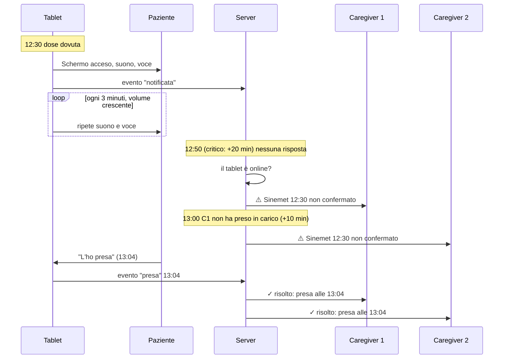

# 4. Promemoria, escalation e funzionamento offline

## 4.1 La sequenza di una dose

## 4.2 I tre livelli

| Livello | Chi | Quando | Scopo |
|---------|-----|--------|-------|
| **1. Promemoria** | Paziente (tablet e telefono) | All'ora prevista | Far prendere la dose |
| **2. Insistenza** | Paziente | Ogni pochi minuti finché non risponde | Superare distrazione, sonno, udito debole |
| **3. Escalation** | Caregiver, in ordine | Dopo una soglia di ritardo | Far intervenire una persona |

Più un'informazione **informativa** non urgente (dose non presa con motivo, variazione salvata, scorta bassa, riepilogo giornaliero), che non segue la catena di escalation e rispetta sempre le ore di silenzio.

## 4.3 Tempi predefiniti

Tutti configurabili per paziente, con possibilità di eccezione per farmaco.

| Parametro | Farmaco normale | Farmaco a orario critico |
|-----------|:---:|:---:|
| Pre-avviso ("tra 5 minuti: Sinemet") | spento | spento (attivabile) |
| Ripetizione del suono e della voce | ogni 3 min per 15 min, poi ogni 10 min | ogni 2 min per 15 min, poi ogni 5 min |
| Rinvio ("Tra 10 minuti") | 10 min, max 3 volte | 10 min, max 1 volta |
| **Prima allerta al caregiver** | +45 min | **+20 min** |
| Passaggio al caregiver successivo se nessuno prende in carico | +15 min | +10 min |
| Dose → *mancata* | +3 ore, o 30 min prima della dose successiva dello stesso farmaco | +90 min, o 30 min prima della successiva |
| Conferma in anticipo consentita | fino a 60 min prima | fino a 30 min prima |

Perché la soglia del Sinemet è così stretta: nel Parkinson un ritardo di 15–30 minuti sulla levodopa può già dare un peggioramento motorio. Il ritardo con cui si avvisa il familiare deve lasciargli il tempo di telefonare prima che succeda.

## 4.4 Escalation verso i caregiver

- **Catena ordinata**: l'amministratore definisce l'ordine (Giovanni → Maria → …). Ogni caregiver può avere ore di silenzio; durante le sue ore di silenzio viene saltato.
- **Presa in carico**: il primo che tocca "Me ne occupo io" ferma la catena per quella dose. Gli altri ricevono un'informazione "Giovanni se ne sta occupando".
- **Risoluzione**: quando la dose viene confermata (da chiunque), tutti quelli che avevano ricevuto l'allerta ricevono "✓ risolto" e la notifica precedente viene aggiornata dove il canale lo consente.
- **Accorpamento**: più dosi dello stesso paziente in allerta nello stesso momento diventano un unico messaggio.
- **Tablet offline**: se il tablet non dà segni di vita, il server non può sapere se la dose è stata presa. Invece di "dose mancata", l'allerta dice "Il tablet di Mamma è offline da 40 minuti: non sappiamo se ha preso il Sinemet delle 12:30". È un'allerta diversa, con l'invito a telefonare.
- **Ore di silenzio e farmaci critici**: se tutta la catena è in silenzio, le allerte dei farmaci critici vengono comunque inviate al primo della catena. Le altre aspettano la fine del silenzio.
- **Mai allarmi falsi in pausa**: durante una pausa totale (ricovero, viaggio) nessuna allerta.

## 4.5 Canali

| Canale | Per chi | Uso | Fase |
|--------|---------|-----|------|
| Schermata, suono e voce sul tablet | Paziente | Promemoria | MVP |
| Notifica push web (PWA) | Paziente (telefono), caregiver | Promemoria, allerte, informazioni | MVP caregiver, F1 paziente |
| **Telegram** (bot Pinnuli) | Caregiver | Allerte con pulsanti "L'ha presa" / "Me ne occupo io"; riepilogo giornaliero | MVP |
| Email | Caregiver | Accesso, inviti, informazioni non urgenti, riepilogo settimanale | MVP |
| SMS | Caregiver | Allerte, come riserva se push e Telegram falliscono | F2 |
| Chiamata vocale automatica | Caregiver | Allerte critiche non prese in carico | F2 |
| App nativa (Android/iOS) | Paziente (telefono) | Promemoria tipo sveglia, anche in modalità silenziosa | F2 |

Telegram è nell'MVP perché è gratuito, affidabile, non dipende dal browser e permette pulsanti di azione direttamente nel messaggio. Ogni canale è facoltativo; almeno uno deve essere attivo per ricevere le allerte.

**Notifiche discrete**: opzione per non mostrare il nome del farmaco nell'anteprima della notifica sul telefono del caregiver ("Promemoria per Mamma: dose non confermata"), per la privacy sullo schermo bloccato.

## 4.6 Offline e sincronizzazione

Il tablet deve fare il suo lavoro anche se internet non c'è.

**Cosa il tablet tiene in locale**
- Le dosi delle prossime 72 ore, con i dati necessari per mostrarle (nomi, quantità, istruzioni, foto in cache).
- La coda degli eventi non ancora inviati (conferme, rinvii, "non la prendo").
- L'ultima differenza nota tra il proprio orologio e quello del server.

**Come scattano i promemoria**
Il tablet calcola da solo quali dosi sono dovute, ogni 15 secondi, partendo dai dati locali. Non dipende da un messaggio del server. Il server fa lo stesso calcolo per le escalation.

**Come si inviano gli eventi**
Ogni evento ha un identificativo univoco generato sul dispositivo e l'ora reale in cui è successo. Il tablet lo invia; se non ci riesce lo rimette in coda e riprova con attesa crescente. Il server ignora i duplicati (stesso identificativo), quindi inviare due volte non fa danni.

**Conflitti**
Il server conserva tutti gli eventi (non sovrascrive). Lo stato della dose si calcola dagli eventi:
- *presa* vince su *mancata* (lo stato automatico cede sempre a una dichiarazione umana);
- tra due dichiarazioni umane in contrasto vince quella con l'ora reale più recente e il caregiver riceve una segnalazione "da verificare".

**Aggiornamenti in tempo reale**
Quando è online, ogni dispositivo riceve dal server gli aggiornamenti entro pochi secondi (conferma dal telefono → il tablet chiude il promemoria; modifica alla terapia → il tablet aggiorna la lista).

## 4.7 Affidabilità del promemoria sul tablet

Un browser non è nato per fare da sveglia. Accorgimenti previsti:

| Rischio | Contromisura |
|---------|--------------|
| Il browser rallenta i timer quando lo schermo è spento o la pagina non è in primo piano | Tablet in modalità chiosco con app dedicata (es. Fully Kiosk Browser su Android) che tiene la pagina sempre in primo piano e può riaccendere lo schermo; schermo sempre acceso ma attenuato; Wake Lock API. Il controllo ogni 15 secondi recupera comunque i ritardi. |
| L'audio parte solo dopo un'interazione dell'utente | Autoplay consentito nelle impostazioni del browser chiosco; il tocco di "Buongiorno" sblocca comunque l'audio; il tablet segnala al server se l'audio è bloccato. |
| Voce sintetica assente o di cattiva qualità | Sintesi vocale del dispositivo (voce italiana di sistema); in alternativa file audio pre-generati dal server per ogni promemoria. |
| La pagina si blocca o si chiude | Il browser chiosco ricarica la pagina se non risponde; l'app espone un controllo di salute che il browser chiosco può verificare. |
| Aggiornamento dell'app durante un promemoria | Le nuove versioni vengono applicate solo quando non ci sono promemoria attivi né dosi nei 10 minuti successivi. |
| Il tablet resta senza rete per giorni | Oltre le 72 ore di dati locali il tablet mostra "Non riesco a collegarmi. Chiama Giovanni" invece di una lista vuota. |

## 4.8 Testi dei promemoria

Regole di scrittura, applicate a voce e a schermo:
- Nome del paziente, ora, farmaco, quantità. Nient'altro. "Anna, sono le otto e mezza. È l'ora del Sinemet: una compressa."
- Quantità sempre a parole e con disegno: "**mezza** compressa", "**due** compresse".
- Istruzioni come azione, al presente: "Prima vai in bagno.", "Sciogli la bustina in un bicchiere d'acqua."
- Mai frasi ambigue come "Annulla" sul tasto di rifiuto: si usa "Non la prendo".
- Nessun allarmismo nella voce: tono gentile e costante anche alla decima ripetizione.
- Per i gruppi: "Sono le dieci e mezza. È l'ora di due medicine: Sinemet Retard e Lactoflorene."
