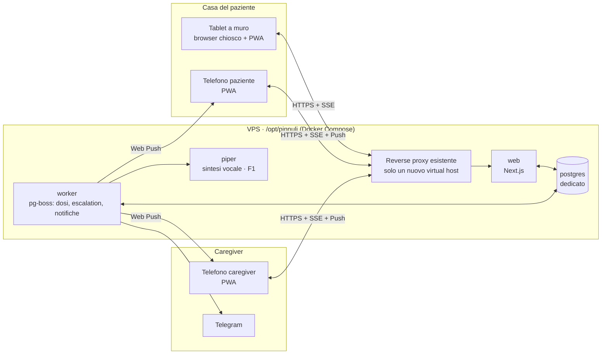

# 6. Architettura e stack tecnico

## 6.1 Scelte in sintesi

| Area | Scelta | Motivo |
|------|--------|--------|
| Tipo di app | **Web app installabile (PWA)**, una sola base di codice per tablet, telefono e computer | Il tablet a muro funziona con un browser in modalità chiosco; nessun app store per partire; un'app nativa leggera si aggiunge in F2 riusando lo stesso codice (Capacitor). |
| Linguaggio | **TypeScript** ovunque | Un solo linguaggio tra client, server e motore delle regole; tipi condivisi. |
| Framework web | **Next.js** (App Router, React) | Landing, app paziente e app caregiver nello stesso progetto; rendering lato server per la landing; ecosistema ampio. |
| Componenti UI | **React Aria Components** + **Tailwind CSS** | React Aria gestisce focus, tastiera, lettori di schermo e "pressione" in modo accessibile (incluse le regole di § 5.3); Tailwind per i design token del brand. |
| Database | **PostgreSQL 17** | Affidabile, transazionale, adatto a dati sanitari e audit. |
| Accesso ai dati | **Drizzle ORM** + migrazioni versionate | Leggero, vicino all'SQL, tipizzato. |
| Code e job pianificati | **pg-boss** (coda su PostgreSQL) | Escalation, generazione dosi, notifiche, report senza aggiungere Redis. |
| Tempo reale | **Server-Sent Events** + `LISTEN/NOTIFY` di PostgreSQL | Semplice da far passare dietro qualsiasi reverse proxy; basta per aggiornare tablet e telefoni. |
| Offline | **Service worker** (Serwist) + **IndexedDB** (Dexie) | Cache dell'app, dosi delle prossime 72 ore, coda degli eventi. |
| Date e fusi orari | **Temporal** (con polyfill dove serve) | Gestione corretta di fusi e ora legale, regola d'oro per un'app di orari. |
| Autenticazione caregiver | **Better Auth**: link via email + passkey; sessioni in cookie HttpOnly | Nessuna password da ricordare, adatto a utenti non esperti. |
| Autenticazione dispositivi | Token per dispositivo, legato a un paziente e a un ruolo "paziente", revocabile, in cookie HttpOnly | Il tablet non ha utente né password. |
| Notifiche push | **Web Push** (standard VAPID, libreria `web-push`) | Gratuito, nessun servizio terzo obbligatorio. |
| Messaggi ai caregiver | **Bot Telegram** (webhook) | Affidabile, gratuito, pulsanti di azione nel messaggio. |
| Email | SMTP verso un provider europeo (es. Brevo) o il server di posta già in uso | Accesso, inviti, riepiloghi. |
| Voce | **Web Speech API** del dispositivo; in F1 file audio generati sul server con **Piper** (sintesi vocale open source, voci italiane, gira in locale) | Funziona offline; qualità uniforme tra dispositivi con Piper. |
| Report PDF | `@react-pdf/renderer` | Niente browser headless sul server, consumi bassi. |
| Test | **Vitest** (motore regole, logica), **Playwright** (end-to-end, tablet e telefono emulati), **axe-core** (accessibilità) | |
| Log e monitoraggio | Log JSON (pino) senza dati sanitari; endpoint di salute; monitor esterno (es. Uptime Kuma o healthchecks) | Leggero, adatto a una VPS condivisa. |
| Rilascio | **Docker Compose**; immagini costruite da GitHub Actions su GHCR; aggiornamento sulla VPS via SSH | Isolato da tutto il resto della VPS (§ 6.7). |

Alternative considerate e scartate per ora: **Supabase/Firebase** (dipendenza da terzi o installazione pesante, dati sanitari fuori dal nostro controllo), **app native fin da subito** (doppio sviluppo e store prima di aver validato il prodotto), **Redis** (non necessario con pg-boss), **WebSocket** (più complessi da far passare nei proxy, SSE è sufficiente).

## 6.2 Componenti



- **web**: pagine, API per l'app caregiver, API per i dispositivi, flusso SSE.
- **worker**: lo stesso codice in un processo separato, che esegue i job: generazione delle dosi, controllo delle dosi dovute ed escalation (ogni 30 secondi), invio notifiche, controllo segnali di vita, riepiloghi, pulizia.
- **postgres**: database dedicato a Pinnuli, non condiviso con altri progetti.

## 6.3 Struttura del repository

```
pinnuli/
├── apps/
│   ├── web/            # Next.js: landing, app paziente (/t), app caregiver (/app), API
│   └── worker/         # processi pianificati e coda
├── packages/
│   ├── core/           # motore delle regole: dalla terapia alle dosi. Puro, senza I/O, testatissimo
│   ├── db/             # schema Drizzle, migrazioni, query
│   ├── ui/             # componenti accessibili e design token del brand
│   └── config/         # configurazioni condivise (TypeScript, lint)
├── docs/               # questa documentazione
├── deploy/             # docker-compose, esempio di virtual host, script di backup
└── .github/workflows/  # CI: test, build immagini, deploy
```

Il pacchetto **core** è la parte più delicata: riceve farmaci, regole, routine, variazioni e un intervallo di date e restituisce le dosi. Non conosce database né rete, quindi si testa con centinaia di casi, a partire dalla terapia reale della prima paziente ([02 § 2.9](02-modello-terapia.md#29-esempio-reale-la-terapia-attuale-della-prima-paziente)) e dalle situazioni limite ([03 § H](03-casi-d-uso.md#h-situazioni-limite)). La stessa funzione gira sul server (per generare e per le escalation) e sul tablet (per l'offline).

## 6.4 Modello dati (tabelle principali)

| Tabella | Contenuto essenziale |
|---------|----------------------|
| `circles` | cerchio di cura, tipo (famiglia/struttura), piano |
| `users` | caregiver: nome, email, lingua |
| `memberships` | utente ↔ cerchio, ruolo, posizione nella catena di escalation, ore di silenzio |
| `patients` | cerchio, nome visualizzato, foto, fuso orario, preferenze (testo, volume, voce, soglie), stato pausa |
| `routine_slots` | paziente, momento (risveglio, pranzo…), orario per giorno della settimana |
| `routine_overrides` | paziente, data, momento, orario (es. "oggi pranzo alle 14") |
| `medications` | paziente, nome, forma, dosaggio, foto, istruzioni, critico, se dimenticato, scorta, stato |
| `schedule_rules` | farmaco, quantità, tipo di orario e parametri, ricorrenza, validità, versione |
| `rule_overrides` | variazioni temporanee: periodo, bersaglio, tipo, valori, motivo, autore |
| `doses` | regola, versione, paziente, ora prevista (UTC + locale), giornata, quantità, stato calcolato, gruppo |
| `dose_events` | dose, tipo, ora reale, ora di ricezione, autore (utente o dispositivo), id generato dal client (univoco), dati |
| `devices` | paziente, tipo (tablet/telefono), nome, hash del token, ultimo segnale, batteria, versione |
| `push_subscriptions` | utente o dispositivo, endpoint, chiavi |
| `notification_channels` | utente, canale (push/telegram/email), riferimento, attivo |
| `alerts` | dose o dispositivo, livello, destinatari, stato (inviata, presa in carico, risolta) |
| `audit_log` | chi, cosa, quando, prima/dopo; mai modificabile |
| `consents` | paziente, tipo, testo/versione, chi, come, quando |

Ogni tabella con dati del cerchio ha `circle_id`; tutte le query passano da un livello che lo impone (isolamento tra famiglie). In aggiunta, Row Level Security di PostgreSQL come seconda barriera (F1).

## 6.5 API per i dispositivi del paziente

| Metodo | Percorso | Scopo |
|--------|----------|-------|
| POST | `/api/device/pair` | Scambia il codice di 6 cifre con il token del dispositivo |
| GET | `/api/device/plan?from=…&to=…` | Dosi, farmaci e routine per le prossime 72 ore (con ETag per scaricare solo se cambiato) |
| POST | `/api/device/events` | Invio a lotti degli eventi (presa, rinvio, non presa, annulla, buongiorno, aiuto), idempotente sull'id del client |
| POST | `/api/device/heartbeat` | Segnale di vita: batteria, alimentazione, ora del dispositivo, audio sbloccato, versione |
| GET | `/api/device/stream` | Flusso SSE: dose aggiornata da un altro dispositivo, terapia cambiata, comando "ricarica" |

L'app caregiver usa azioni server di Next.js e lo stesso flusso SSE per lo stato in tempo reale.

## 6.6 Domini

| Dominio | Uso |
|---------|-----|
| `pinnuli.it` | Sito di presentazione (italiano) |
| `app.pinnuli.it` | Web app (paziente e caregiver). Sottodominio separato per isolare cookie e service worker dalla landing. |
| `pinnuli.com` | Reindirizzamento permanente a `pinnuli.it` (in futuro sito in inglese) |

## 6.7 Installazione sulla VPS senza toccare gli altri progetti

Principio: **Pinnuli aggiunge, non modifica.** Ogni cosa sta in una cartella propria, in container propri, su una rete Docker propria, con un database proprio.

**Prima di installare (sola lettura sulla VPS)**
1. Sistema operativo, RAM e disco liberi.
2. Docker e Docker Compose presenti? Versione?
3. Quale reverse proxy è in uso (Nginx, Caddy, Traefik, Apache) e come sono gestiti i certificati.
4. Porte già occupate (`ss -tlnp`), reti Docker esistenti, nomi dei container.
5. Firewall attivo e regole correnti.
6. Backup esistenti.
Il risultato è una nota in `deploy/vps-inventario.md` (senza segreti) e un piano di installazione da approvare prima di eseguirlo.

**Regole di installazione**
- Cartella `/opt/pinnuli/`, utente di sistema dedicato `pinnuli`.
- Progetto Compose con nome `pinnuli`; container e volumi con prefisso `pinnuli_`; rete Docker dedicata `pinnuli_net`.
- **PostgreSQL dedicato** in container, non esposto all'esterno, volume proprio. Nessun uso di database già presenti.
- L'app ascolta solo su `127.0.0.1` con una porta libera verificata (es. `127.0.0.1:38100`).
- Nel reverse proxy esistente si **aggiunge un solo file** di virtual host per `app.pinnuli.it` e `pinnuli.it`, si verifica la configurazione (`nginx -t` o equivalente) e si ricarica senza riavviare. Nessuna modifica ai virtual host esistenti.
- Certificati TLS con lo stesso meccanismo già in uso sulla VPS.
- Nessuna modifica al firewall se le porte 80/443 sono già aperte (quasi certamente lo sono).
- Limiti di memoria e CPU sui container di Pinnuli, perché un problema di Pinnuli non rallenti gli altri progetti.
- Consumo previsto nell'MVP: circa 600–900 MB di RAM in tutto, meno di 2 GB di disco più i backup.

**Rilascio continuo**
GitHub Actions esegue test e build, pubblica le immagini su GitHub Container Registry, poi si collega alla VPS con una chiave SSH dedicata, limitata alla cartella di Pinnuli, ed esegue `docker compose pull && docker compose up -d` con migrazioni del database. Rollback: si rimette il tag dell'immagine precedente.

**Backup**
Dump notturno di PostgreSQL, cifrato (age o restic), copiato fuori dalla VPS (storage S3-compatibile in UE), conservato 30 giorni. Prova di ripristino documentata e ripetuta ogni 3 mesi. Le foto dei farmaci sono in un volume incluso nel backup.

## 6.8 Notifiche e canali

| Destinatario e piattaforma | Affidabilità | Note |
|----------------------------|--------------|------|
| Tablet a muro (pagina sempre aperta) | **Alta** | Il promemoria non dipende dalle notifiche push: la pagina è aperta e scatta da sola. |
| Telefono Android, PWA installata | Buona | Push con suono; possibile ritardo se il telefono è in risparmio energetico aggressivo. |
| iPhone, PWA installata nella Home (iOS 16.4+) | Media | Push funziona, ma niente suono personalizzato e niente superamento della modalità silenziosa. |
| Telegram | Alta | Consigliato come canale principale per le allerte ai caregiver. |
| App nativa (F2) | Alta | Notifiche locali tipo sveglia per il telefono del paziente. |

## 6.9 Il tablet a muro

**Raccomandazione: tablet Android da 10–11 pollici.**
- Su Android un browser chiosco (es. **Fully Kiosk Browser**, licenza a pagamento economica) permette: avvio automatico della pagina, schermo sempre acceso o riacceso all'ora del promemoria, luminosità programmata, audio automatico consentito, ricarica della pagina se si blocca, blocco delle altre app, impedire l'uscita al paziente.
- Un iPad funziona (Accesso guidato + PWA) ma con meno controllo su riaccensione dello schermo e audio: va bene come seconda scelta.

**Installazione fisica**
- Supporto a muro con cavo di alimentazione nascosto, all'altezza degli occhi da seduti o in piedi a seconda di dove si trova la paziente di solito (spesso vicino al tavolo della cucina, dove si prendono le medicine).
- Lontano da finestre che creano riflessi.
- Limite di carica della batteria all'80–85% se il tablet lo permette, per non rovinarla stando sempre in carica.
- Wi-Fi di casa con buona copertura in quel punto.
- Volume di sistema al massimo e bloccato; volume reale gestito da Pinnuli.

**Guida di configurazione**: verrà fornita una guida passo passo (con foto) per il familiare, generata per il modello di tablet scelto.

## 6.10 Prestazioni e qualità

- La schermata del paziente deve essere interattiva in meno di 2 secondi anche su un tablet economico e ripartire in meno di 5 secondi dopo un riavvio.
- Dal tocco al cambio visivo: meno di 100 ms (nessuna attesa della rete: la conferma è locale e poi sincronizzata).
- Da conferma su un dispositivo a aggiornamento sugli altri: meno di 5 secondi quando online.
- Errore massimo dell'orario di un promemoria: 30 secondi.
- Copertura dei test del pacchetto `core`: 100% delle righe e tutti i casi della sezione H.
